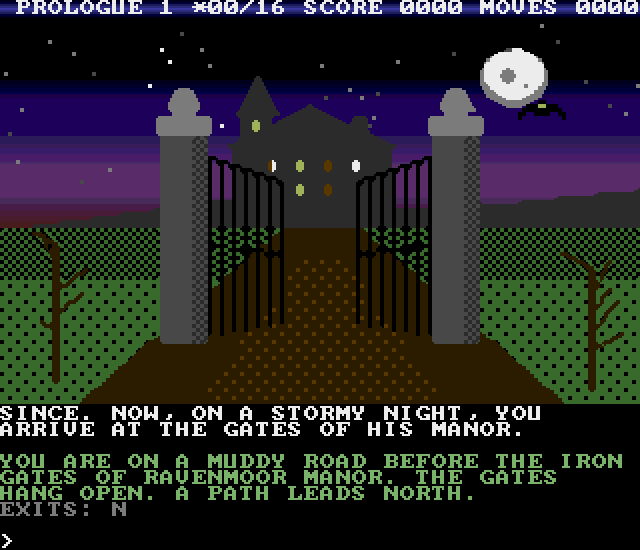
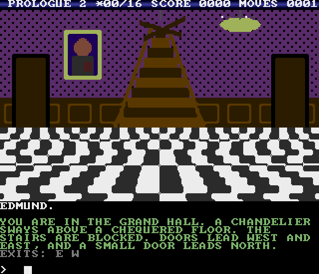
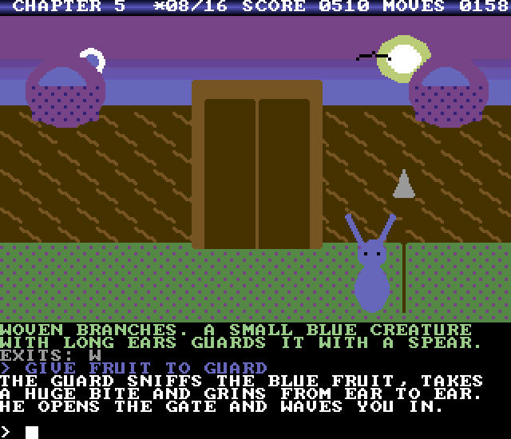
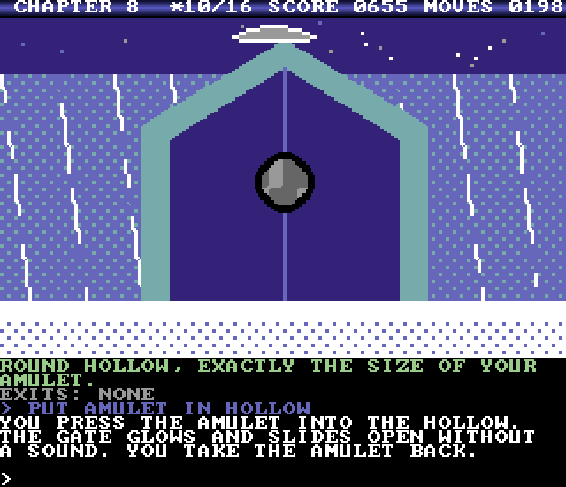
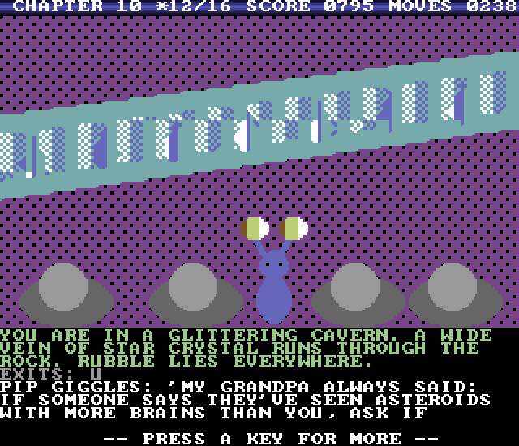
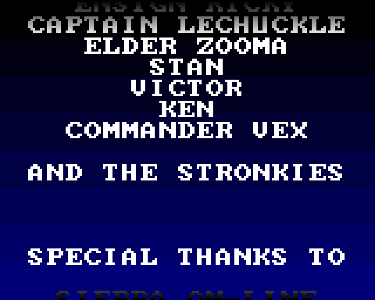
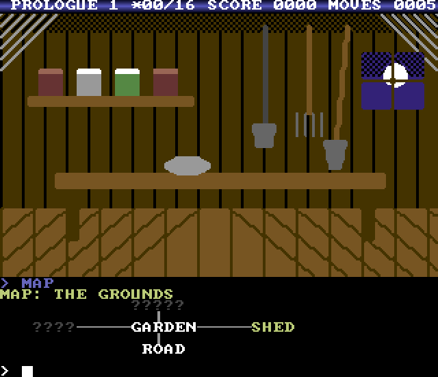

# The World of Stronkie: Amiga 500 version

The C64 adventure, converted to the Amiga 500.

Created By Mark Stronks

**Current version: V1.0**. Download the bootable disk `The_World_of_Stronkie_Amiga_V1.0.adf`, or the same disk in `The_World_of_Stronkie_Amiga_V1.0.zip`.

This is a side project: the main game is the C64 version in the root of this repository. The story, the puzzles, all 17 parts and 92 locations, the star fragments and the true ending are the same. The walkthrough from the C64 version scores the same 1070 points here.

## What you need

- An Amiga 500 with **1 MB chip RAM** (Fat Agnus 8372A, OCS or ECS)
- Kickstart 1.3 or higher
- One floppy drive. To save games, the disk must not be write-protected.

You can also play it in an emulator: WinUAE, FS-UAE or vAmiga, set up as an A500 with 1 MB chip RAM. The game was tested in vAmiga.

## How to play

1. Write `The_World_of_Stronkie_Amiga_V1.0.adf` to a floppy disk, or insert it in DF0: of your emulator.
2. Switch on the Amiga. The game boots by itself.
3. The title screen appears with music, copper bars and a scroller. Part 1 loads in the background.
4. Press `N` for a new game, or `L` to load a saved game (then press the slot, 1 to 3). `ESC` takes you back to the Workbench or CLI.

You play exactly as on the C64: type two-word commands like `TAKE KEY`, `OPEN DOOR` and `TALK TO NOVA`, and press RETURN. `MAP` shows the map of the part you are in, `HINT` gives a clue (it costs 3 points) and `G` repeats your last command.

| Key | What it does |
|---|---|
| `F1` | load a saved game |
| `F3` | save the game (slot 1, 2 or 3) |
| `F5` | music on/off |
| `F7` | quit to the title screen |
| `HELP` | the HELP command |

Saved games are AmigaDOS files on the game disk, named after the slot and the part (for example `SAVE1-GROUNDS`).

## The Amiga hardware at work

- **Copper:** every room with a sky gets a smooth gradient that changes colour on every line (192 colours a picture instead of 12). The copper also draws the raster bar behind the status line, the moving copper bars on the title screen, the palette fades between rooms, the lightning flashes and the background of the title cards.
- **Pictures:** the room pictures are scaled up to 320x192 with Scale2x and shown in 32 colours (5 bitplanes). They are decoded in the background while the game waits for your command, so moving between rooms is quick.
- **Colour cycling:** stars twinkle, fires burn and lamps flicker by cycling 8 colour registers. It costs no processor time.
- **Blitter:** smooth scrolling of the text window and fast picture copies.
- **Sprites:** bats, birds, comets, clouds and ships move across the pictures. Each one uses 2 or 3 hardware sprites.
- **Paula:** in-game music on 3 voices and sound effects on the 4th voice, so the music no longer stops for a sound effect. The waveforms are triangle, saw, 16 pulse widths and noise, and the volume follows a software ADSR envelope.
- **Title screen:** a new title picture, an original 4-voice title tune, copper bars, a scroller and a spaceship sprite.
- **System friendly:** the game keeps AmigaDOS running so it can load and save files. It catches all keys with an input handler and returns cleanly to the Workbench or CLI.

You can hear the title music without an Amiga: [`title_music_preview.wav`](title_music_preview.wav) is a recording made with the same instruments.

## Screenshots

| | |
|---|---|
|  |  |
|  |  |
|  |  |
|  |  |

## Files

| File / folder | What it is |
|---|---|
| `The_World_of_Stronkie_Amiga_V1.0.adf` | the bootable game disk (OFS) |
| `The_World_of_Stronkie_Amiga_V1.0.zip` | the same disk, zipped |
| `bin/` | the files on the disk: `Stronkie` (the program), `MENU` (title screen), `PART01`-`PART17` (packed game data) |
| `source/` | the 68000 assembler source of the engine: `stronkie.s` (start-up, parser, game logic), `video.s` (copper, blitter, sprites, text, pictures, title screen, cards, credits), `audio.s` (Paula music and sound effects), `data.s` (texts, variables, buffers), `tables.i` (generated tables) |
| `source/data/` | the source of every data file: `part01.s`-`part17.s` and `menu.s` |
| `source/build_amiga.py` | builds the data files from the C64 story files, assembles everything and makes the ADF |
| `source/tools/` | the test harness: a 68000 emulator (Musashi) with a small stand-in for the Amiga OS that plays the whole walkthrough, and a screenshot renderer |
| `screenshots/` | screenshots |

### Building from source

You need [vasm](http://sun.hasenbraten.de/vasm/) (`vasmm68k_mot`), Python 3 with Pillow, [amitools](https://github.com/cnvogelg/amitools) (`xdftool`) and the C64 project files. Then run `python3 build_amiga.py all`. Each data file is assembled with `vasm -Fbin` and packed with the same packer as the C64 version (zxpack). The program is assembled with `vasm -Fhunkexe -kick1hunks`.

## Credits

- Game, story and pictures: Mark Stronks AKA Stronkie
- Title picture: based on the original The World of Stronkie artwork
- Font: font8x8 by Daniel Hepper (public domain)

## Versions

| Version | Date | Changes |
|---|---|---|
| V1.0 | November 2026 | First Amiga 500 version |

### Changelog

**V1.0**
- The complete C64 adventure (V1.7) on one bootable Amiga disk: all 17 parts, the same parser and the same puzzles, MAP, HINT, three save slots and the true ending.
- Room pictures in 320x192 with 32 colours, Scale2x smoothing, copper sky gradients on every line, colour cycling, palette fades and lightning flashes.
- Moving sprites, a smooth-scrolling text window, a raster bar behind the status line.
- New title screen with copper bars, a scroller and an original 4-voice title tune.
- Title cards with the first room of the next part while it loads. The music keeps playing while the disk loads.
- Paula music on 3 voices and sound effects on the 4th voice.
- Rolling end credits with copper fades.
