# The World of Stronkie
Adventure Game made for the Commodore Amiga 500

Created By Mark Stronks

**Current version: V2.0**. The game comes on three disks: download `The_World_of_Stronkie_Amiga_V2.0_Disk1.adf`, `The_World_of_Stronkie_Amiga_V2.0_Disk2.adf` and `The_World_of_Stronkie_Amiga_V2.0_Disk3.adf`, or all three at once in `The_World_of_Stronkie_Amiga_V2.0.zip`.

New in V2.0: every picture in the game is new. All 81 pictures were painted again for the Amiga, in 320x192 pixels and 32 colours, each with its own palette, copper sky and colour cycling. The game also has **sampled sound effects** and **speech**: the title screen welcomes you, every title card speaks the name of the next part, and NOVA, the ship's computer, talks to you.

All 81 pictures on one page: [`all_pictures.png`](all_pictures.png). Every picture is also in the [`pictures`](pictures) folder.

Hear the sound effects and the speech without an Amiga: [`sound_and_speech_preview.wav`](sound_and_speech_preview.wav) is decoded from the game files, exactly as the Amiga plays them. [`title_music_preview.wav`](title_music_preview.wav) is the title tune.

This is the Amiga 500 version of the C64 game in the root of this repository. The story, the puzzles, all 17 parts and 92 locations, the star fragments and the true ending are the same, and the [walkthrough](../walkthrough.txt) scores the same 1070 points. Older Amiga versions are in the `previous releases` folder.

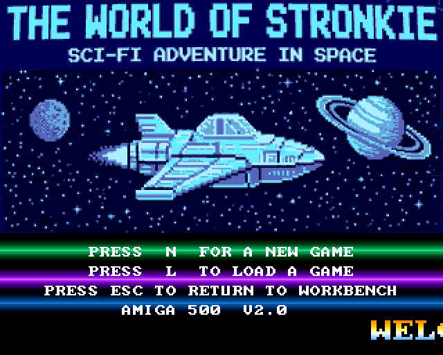

## What is the game about

The World of Stronkie is a text and graphics adventure in the style of the classic 1980s adventure games. You explore the world by typing commands, every location has its own picture, and you solve puzzles by finding, combining and using objects.

### Storyline

A letter from your uncle Edmund brought you to Ravenmoor Manor: *"Come to Ravenmoor at once. I have found it."* Nobody has seen him since. What starts as a mystery in an old manor turns out to be the beginning of a journey through space, to a planet that was lost long ago: **the World of Stronkie**.

**Prologue – Ravenmoor**

- **Part 1 – The Grounds:** on a stormy night you arrive at the gates of the manor. Search the overgrown garden, the shed and the old well to find a way inside.
- **Part 2 – The Manor:** explore the hall, the kitchen, the dark cellar, the study and the library, and find the secret chamber where uncle Edmund is held prisoner. He reveals that the amulet is no jewel: it is the key to a starship hidden beneath the house.
- **Part 3 – The Launch Pad:** a hidden stairway leads to a bunker and a giant hangar carved into the rock. There stands the silver starship STARRAVEN. Find a keycard and a flight suit, power up the launch systems with the amulet, board the ship and blast off through the opening roof, while soldiers break into the manor above.

**The space adventure**

The space chapters are full of nods to the classic adventure games: Space Quest, Leisure Suit Larry, Monkey Island, The Hitchhiker's Guide to the Galaxy and Star Trek. And watch out for a certain C64 programmer called Mark Stronks AKA Stronkie...

- **Chapter 1 – Into Space:** the ship's computer NOVA wakes up. The navigation crystal cracked during the launch. Find magnetic boots for the zero-gravity cargo hold, pry open the spare-parts crate, repair the navigation and jump into hyperspace.
- **Chapter 2 – The Derelict Station:** dock at the abandoned space station KX-9. Get past the security robot, restart the generator and take the star chart that shows the way to the World of Stronkie.
- **Chapter 3 – Asteroid 42:** the hyperjump drained the fuel cells, so NOVA lands on Asteroid 42, the most wretched hive of scum and villainy this side of Andromeda. A fuel cell costs 50 buckazoids and you have none. Help Roger the janitor, find the password for Lefty's back room, outsmart the Slots-o-Death machine and do business with Stan.
- **Chapter 4 – Space Pirates:** Captain LeChuckle's pirate ship, the SPACE MONKEY, grabs you with a tractor beam. Cross to the pirate ship in a very unusual way, beat the guard at insult swordfighting, trick the captain and switch off the beam.

**The World of Stronkie**

- **Chapter 5 – Landfall:** hit by the pirates' parting shot, the STARRAVEN crash-lands in a purple jungle under two suns. Blow the jammed hatch, put out the burning engine, swing across a glowing river and break a new power crystal loose for the ship. A hungry little Stronkie guards the gate to his village...
- **Chapter 6 – The Village:** the Stronkies only chirp until you find a way to understand them. Elder Zooma tells you the truth: your amulet is the key of the Sky Temple, where the Star Heart keeps the planet alive, and Commander Vex has come to steal its power. Bix the inventor can fly you there, if you find him a sail.
- **Chapter 7 – The Crystal Mountains:** Vex has stolen the amulet from your ship! Cross an ice bridge without waking the beast in the ice cave, sneak into Vex's camp and take the amulet back.
- **Chapter 8 – The Sky Temple:** open the crystal gate, catch the sunlight with a silver mirror and make an invisible bridge appear. But behind the golden door, Vex is waiting.
- **Chapter 9 – The Star Heart:** Vex is draining the Star Heart with his machine. Use the old Stronkie legends to stop him, chase him into the catacombs and trap him. Uncle Edmund turns up just in time to help you save the World of Stronkie... but Vex's flagship beams him up from orbit, and takes Uncle Edmund with him!

**Vex's flagship**

- **Chapter 10 – Repairs:** Bix can repair the STARRAVEN, but he needs a star crystal from the old mines. The tunnels are pitch dark and twist like a maze, so you'll need a friend with glowing ears.
- **Chapter 11 – Vex's Flagship:** sneak aboard the IRON RAVEN. Find a disguise to get past the guards, and beat the Insult-o-Tron 3000 at insult swordfighting with the comebacks you learned along the way.
- **Chapter 12 – The Prison Deck:** free Uncle Edmund, and find out who Commander Vex really is. Some old friends turn up again...
- **Chapter 13 – The Bridge:** Vex's star cannon is aimed at the World of Stronkie. Stop it, and end this once and for all.
- **Epilogue – Home Again:** back at Ravenmoor Manor, where it all began. Did you find all the star fragments? Then the true ending awaits.

**Choices that matter:** some things you do early on (or don't do) change what happens later: who helps you, which way you get past the guards, and whether a secret room opens. You can always finish the game either way.

### What you need

- An Amiga 500 with **1 MB chip RAM** (Fat Agnus 8372A, OCS or ECS). Other Amigas with 1 MB of chip RAM or more work too.
- Kickstart 1.3 or higher
- One floppy drive. A second drive (DF1:) saves you disk swaps: put disk 2 or 3 in it and the game finds it there.
- To save games, the disks must not be write-protected.

You can also play it in an emulator: WinUAE, FS-UAE or vAmiga, set up as an A500 with 1 MB chip RAM. The game was tested in vAmiga.

### How to play

1. Write the three ADF files to floppy disks, or insert `The_World_of_Stronkie_Amiga_V2.0_Disk1.adf` in DF0: of your emulator. Keep disks 2 and 3 ready.
2. Switch on the Amiga with disk 1 in the drive. The game boots by itself.
3. The title screen appears with music, copper bars, a scroller and a spaceship, and a voice says *"Welcome to the World of Stronkie!"*. Part 1 loads in the background.
4. Press `N` to start a new game, or `L` to continue a saved game (then press the slot number, 1 to 3). If there is no saved game in that slot, a new game starts. `ESC` takes you back to the Workbench or CLI.
5. When the game needs a part that is on another disk, it says **PLEASE INSERT DISK 2 AND PRESS A KEY** (or disk 1 or 3). Insert that disk and press a key.

Type two-word commands and press RETURN, for example:

| Command | What it does |
|---|---|
| `N` `S` `E` `W` `U` `D` (or `GO NORTH`) | move around |
| `L` / `LOOK` | describe the location again |
| `I` / `INVENTORY` | show what you are carrying |
| `EXAMINE MAT`, `LOOK UNDER MAT` | look closely at things |
| `TAKE KEY`, `DROP KEY`, `WEAR SUIT`, `INSERT CARD` | pick up, drop, wear and use objects |
| `OPEN DOOR`, `PULL LEVER`, `DIG`, `LIGHT CANDLE`, `PRESS BUTTON`, `TALK TO NOVA` | interact with the world |
| `TAKE ALL`, `DROP ALL` | pick up or drop everything at once |
| `G` / `AGAIN` | repeat your last command |
| `HINT` | a clue for your next step (costs 3 points) |
| `SAVE`, `LOAD` (or `RESTORE`) | save your game in slot 1, 2 or 3 on the disk, and continue it later |
| `MAP` | a map of the part you are in: where you are, where you have been, and the places you haven't seen yet |
| `HELP`, `SCORE`, `QUIT` | help, your score and star fragments, quit to the title screen |
| `MUSIC` | turn the music off or back on (sound effects and speech keep playing) |
| `ESC` on the title screen | leave the game and go back to the Workbench or CLI |

**Function keys** (work at any time while you type a command):

| Key | What it does |
|---|---|
| `F1` | load your saved game (asks first: all progress in this game will be lost) |
| `F3` | save the game in slot 1, 2 or 3, under the name of the part you are in |
| `F5` | music off / on |
| `F7` | quit to the title screen (asks first) |
| `HELP` | the HELP command |

Only the first four letters of a word count, and small words like THE, WITH and UNDER are skipped.

### Score

The status bar above the picture always shows the part you are in, your **score** and the number of **moves** (every command you type counts as one move). You earn points for solving puzzles, for example 10 points for digging up the handle or opening a door. Every time you score, a short jingle plays.

**Star fragments:** almost every part hides one star fragment, worth 10 points each: 16 in total. They only turn up if you search the right place carefully. The status bar shows how many you have found (`*02/16`). Find them all for the true ending!

**Hints:** stuck? Type `HINT` for a clue about your next step. Each hint costs 3 points.

The maximum score is 1070 (with all 16 star fragments, every good choice and the true ending). Rumour has it that there is also something secret hidden on the planet...

Stuck? [walkthrough.txt](../walkthrough.txt) is a complete walkthrough that takes you through the whole game with all 1070 points, all 16 star fragments, every choice that matters, the secret and the true ending, plus a list of jokes and secret commands to try. Try to get it in as few moves as possible, without hints!

### Saving, dying and the three disks

- `SAVE` (or `F3`) asks for a slot: press `1`, `2` or `3` (any other key cancels). The game is written under the slot number and the name of the part you are in, for example `SAVE1-LANDFALL` or `SAVE3-SKYTEMPLE`, so the disk directory shows how far you got in every slot. A new save replaces the old one in that slot. `LOAD`, `RESTORE` or `F1` asks if you are sure and which slot, then brings you back to the exact same spot, with all your items, score, moves and the map. You can type `LOAD` right after starting a new game.
- A save is written to the disk that holds the part you are in (disk 1 for parts 1 to 5, disk 2 for parts 6 to 11, disk 3 for parts 12 to 17), so that disk must not be write-protected. To continue a game, start from disk 1 as usual, insert the disk with your save before you press `L` on the title screen (or put it in DF1:), and the game finds it.
- If you die, the game says *"You have died."* and asks **TRY THIS PART AGAIN?** Press `Y` to restart the current part with the score you had when you entered it, or `N` to go back to the title screen.
- Disk 1 holds the program, the title screen, the sounds and parts 1 to 5 (the prologue up to chapter 2). Disk 2 holds parts 6 to 11 (chapters 3 to 8) and disk 3 parts 12 to 17 (chapter 9 to the epilogue). The game knows the disks by their names, `Stronkie`, `Stronkie2` and `Stronkie3`, so it doesn't matter which drive they are in.
- **Playing from a hard disk:** copy all files from the three disks into one directory, remove the game disks from the drives, then `CD` to that directory in a CLI and type `Stronkie`. The game then loads every part and saves every game in that directory, without asking for disks.

### Features

- 81 new pictures, painted for the Amiga: 320x192 pixels in 32 colours, every picture with its own palette, for the 92 locations in 17 parts (some rooms share a picture, as on the C64), plus a new morning picture for the epilogue
- Copper skies: every sky changes colour on every line, 192 colours a picture on top of its 32
- Animated pictures with colour cycling: twinkling stars, burning fires, rippling water, flickering candles, blinking console lights, glowing crystals, falling snow, a beating Star Heart, force fields and sparking wires
- Moving sprites: bats, birds, comets, clouds, butterflies and ships fly through the pictures
- Speech: a voice welcomes you on the title screen and speaks the name of every part on its title card, NOVA speaks her lines in a robot voice, and you hear *"You have died."* and *"Congratulations!"*
- Sampled sound effects: key clicks, taking and dropping items, errors, points, a creaking door, thunder, an electric zap, the rocket launch, hyperspace, computer beeps, death and a victory fanfare
- Music during the game: every part has its own tune on three voices, and the sound effects and speech use the fourth voice, so the music never stops for them
- Title screen with a painted title picture, an original 4-voice title tune, copper bars, a scroller and a flying spaceship
- Full-screen title cards with a copper gradient: the next part's name is shown and spoken while it loads
- Palette fades between rooms and screen flashes for the lightning, the rocket launch and hyperspace
- A smooth-scrolling text window, coloured text (descriptions green, events white, NOVA cyan, uncle Edmund yellow, points yellow, your commands light blue) and a raster bar behind the status line
- Two-word command parser with about 65 verbs, TAKE ALL / DROP ALL, AGAIN, and messages that tell you which word was not understood
- Save and load in three slots, retry a part after dying, hints, a map of every part and hidden star fragments
- Rolling end credits after the last part
- System friendly: the game keeps AmigaDOS running so it can load and save files, catches all keys with an input handler and returns cleanly to the Workbench or CLI

### Files on the disks

| File | Disk | Contents |
|---|---|---|
| `Stronkie` | 1 | the game program (started by `s/startup-sequence`) |
| `MENU` | 1 | the title screen: picture, title music, scroller and spaceship |
| `SOUNDS` | 1 | the sampled sound effects and the spoken lines of the engine (welcome, died, congratulations) |
| `PART01` | 1 | Prologue, part 1: The Grounds (texts, objects, puzzles, music, sprites, pictures and speech) |
| `PART02` | 1 | Prologue, part 2: The Manor |
| `PART03` | 1 | Prologue, part 3: The Launch Pad |
| `PART04` | 1 | Chapter 1: Into Space |
| `PART05` | 1 | Chapter 2: The Derelict Station |
| `PART06` | 2 | Chapter 3: Asteroid 42 |
| `PART07` | 2 | Chapter 4: Space Pirates |
| `PART08` | 2 | Chapter 5: Landfall |
| `PART09` | 2 | Chapter 6: The Village |
| `PART10` | 2 | Chapter 7: The Crystal Mountains |
| `PART11` | 2 | Chapter 8: The Sky Temple |
| `PART12` | 3 | Chapter 9: The Star Heart |
| `PART13` | 3 | Chapter 10: Repairs |
| `PART14` | 3 | Chapter 11: Vex's Flagship |
| `PART15` | 3 | Chapter 12: The Prison Deck |
| `PART16` | 3 | Chapter 13: The Bridge |
| `PART17` | 3 | Epilogue: Home Again |

All data files are packed. A part file holds the packed part (texts, puzzles, music, sprites and the map), its pictures and its speech, and the title card of the next part. When you save, a file named after the slot and the part you are in (like `SAVE1-MANOR`) is added to the disk of that part. The same files are in the [`bin`](bin) folder.

## How was it created

The engine is written in 68000 machine language (vasm, Motorola syntax). The story and the puzzles are the same data as in the C64 version: the build compiles every C64 chapter and converts it into an Amiga part file.

- **Engine:** start-up and clean exit, the command parser, the inventory and the same small script interpreter for the puzzles as on the C64; loading, saving and unpacking.
- **Display:** the game builds its own copper list. The status bar sits on a raster bar, the picture is shown in 5 bitplanes (32 colours) with the sky colour changing on every line, and the text window below it uses 4 bitplanes. The blitter copies the pictures and scrolls the text window.
- **Pictures (V2.0):** painted with a small painting kit written in Python for this game (`source/art`): perspective rooms, stone, wood, metal and rock textures, light and shadow, glows, plants, crystals, starships and the characters. Every picture is painted at twice the size and scaled down, then the sky goes to the copper, the animated parts get their own colour registers, and the rest gets the best 32-colour palette for that picture (12-bit Amiga colours) with ordered dithering. The pictures are stored as packed chunky pixels, about 18 KB each.
- **Picture cache:** when the game waits for your command, it unpacks and converts the pictures of the part in the background, a few lines at a time, into a cache in chip memory. Moving between rooms then only takes a blitter copy and a palette fade.
- **Colour cycling:** every picture can cycle up to 16 colour registers, from the vertical blank interrupt, so stars, fires, water and lights move without costing the processor any time.
- **Sprites:** the sprite images and the list of which sprites fly in which room come with every part file. Rooms with sprites keep their colour registers free.
- **Music:** a 3-voice player on Paula with generated waveforms (triangle, saw, 16 pulse widths and noise) and a software ADSR envelope plays the tunes of the C64 version. The title tune is an original 4-voice tune.
- **Sound effects and speech (V2.0):** the effects are 8-bit samples, made for this game in Python, and play at 7 kHz on Paula's fourth voice. The speech is made with flite, a free speech synthesizer, at 6.5 kHz, and NOVA's voice gets a ring modulator and a short metallic echo for a robot sound. Samples are packed with Fibonacci delta coding (4 bits a sample, half the size) and unpacked into chip memory when they are needed. The classic Amiga speech (the narrator.device from the Workbench disk) can't be used, because it isn't part of the Kickstart ROM and may not be copied onto the game disks.
- **Disks (V2.0):** the pictures and speech no longer fit on one disk, so the game uses three. The program looks for the volumes `Stronkie`, `Stronkie2` and `Stronkie3` in the DOS list and asks for a disk when it is not in a drive. Started from a hard disk, it uses its own directory.
- **Compression:** every file is packed with the same packer as the C64 version: a bit-oriented LZ packer with an optimal parse, in the spirit of ZX0 (Elias gamma codes for lengths and offsets).
- **Map:** the build lays out the rooms of every part on a grid from their exits and stores the map in the part's file.

Memory use (1 MB chip RAM):

| Buffer | Size | Use |
|---|---|---|
| program | 26 KB | the engine, texts, tables and the font |
| screen | about 140 KB (chip) | copper lists, the picture, the text window, the status bar, the full-screen bitmap for the title screen, cards and credits, sprites and waveforms |
| part file | 192 KB | the part file as loaded from the disk: its pictures and speech stay here while you play the part |
| part | 32 KB | the unpacked part: texts, puzzles, music, sprites, map |
| pixels | 60 KB | one unpacked picture, before it is converted to bitplanes |
| sounds | about 110 KB (chip) | the sound effects, unpacked |
| speech | 28 KB (chip) | the spoken line that plays now |
| picture cache | 38 KB a picture (chip) | up to 8 pictures in bitplanes, as many as the free chip memory allows |
| title screen | 40 KB | the title picture, music and scroller, kept after the first time |

### Credits

- Game, story and pictures: Created By Mark Stronks AKA Stronkie
- Title picture: based on the original The World of Stronkie artwork
- In-game music: the original tunes of the C64 version, one for each part; title music: an original tune for the Amiga version
- Speech: flite, by the Language Technologies Institute at Carnegie Mellon University
- Font: font8x8 by Daniel Hepper (public domain)

## Building from source

You need [vasm](http://sun.hasenbraten.de/vasm/) (`vasmm68k_mot`), Python 3 with NumPy and Pillow, flite, [amitools](https://github.com/cnvogelg/amitools) (`xdftool`) and the C64 project files. Then run `python3 build_amiga.py all`. Each data file is assembled with `vasm -Fbin` and packed; the program is assembled with `vasm -Fhunkexe -kick1hunks`. `python3 source/art/sheet.py scenes1` shows the pictures of one group as a contact sheet.

| File / folder | What it is |
|---|---|
| `source/stronkie.s` | start-up, parser, game logic, disks, save and load, the unpacker |
| `source/video.s` | copper lists, blitter, pictures and the picture cache, sprites, text window, title screen, title cards, credits |
| `source/audio.s` | Paula: the music player, sampled sound effects and speech |
| `source/data.s` | texts, variables and buffers; `tables.i` holds the generated tables |
| `source/data/` | the source of every data file: `part01.s`-`part17.s` and `menu.s` |
| `source/art/` | the pictures: `paint.py` (canvas, palette and dithering), `kit.py` (rooms, textures, props and characters), `scenes1.py`-`scenes4.py` (all 81 pictures) |
| `source/build_amiga.py` | builds the data files, the sounds and the three ADFs; `amiga_sound.py` makes the sound effects and speech |
| `source/soundpreview.py`, `source/musicpreview.py` | make the WAV previews |
| `source/tools/` | the test harness: a 68000 emulator (Musashi) with a small stand-in for the Amiga OS that plays the whole walkthrough, and a screenshot renderer |

## Screenshots

| | |
|---|---|
| 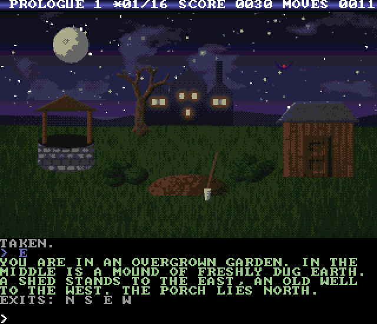 | 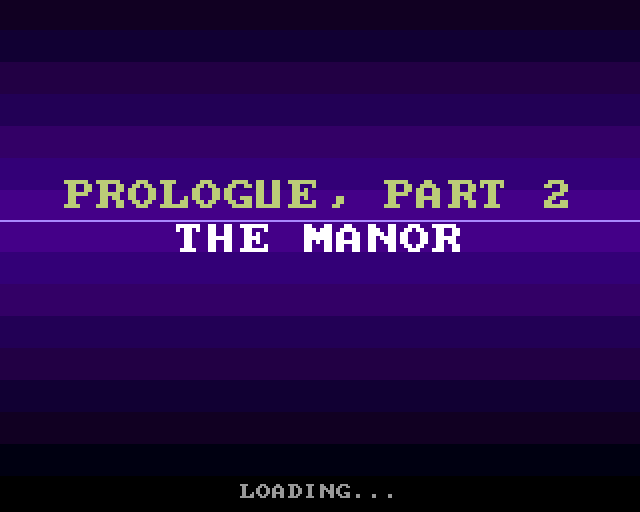 |
| 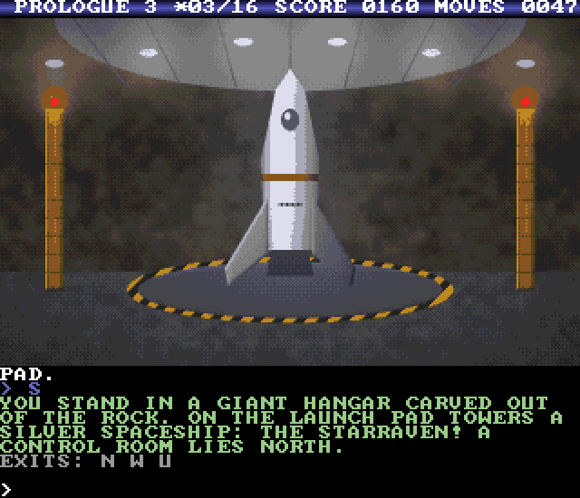 | 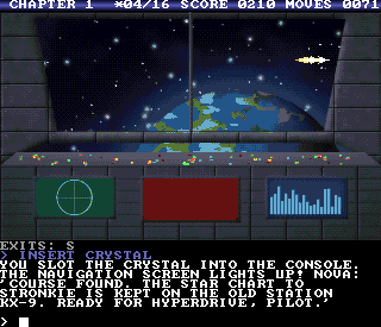 |
| 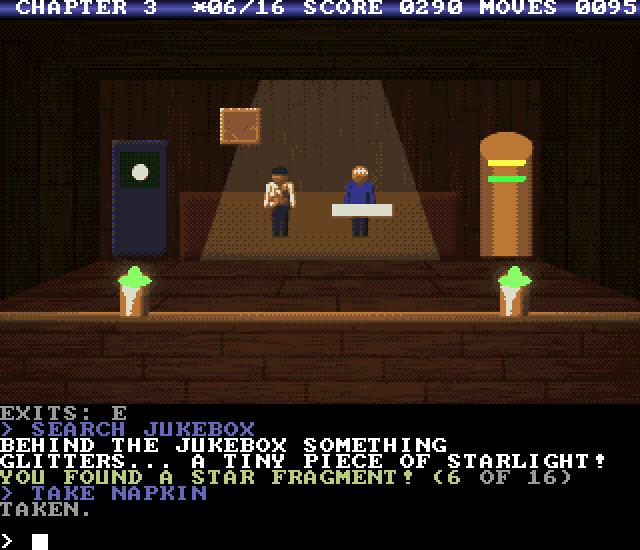 | 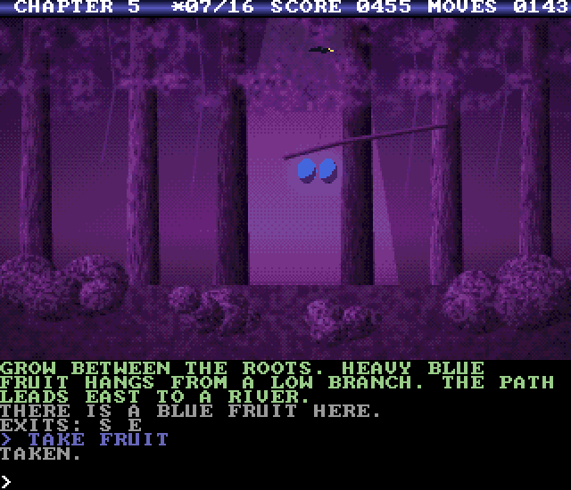 |
| 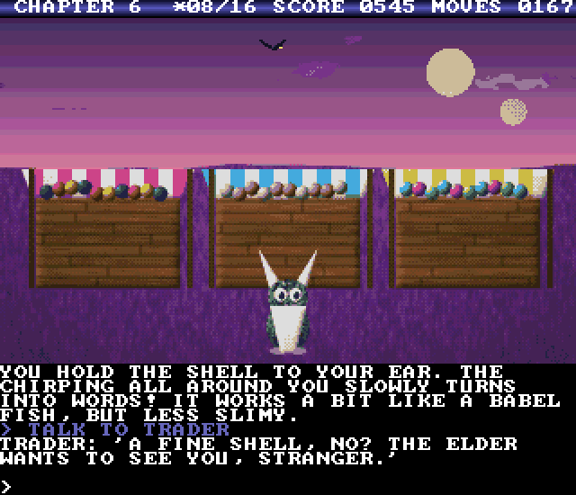 | 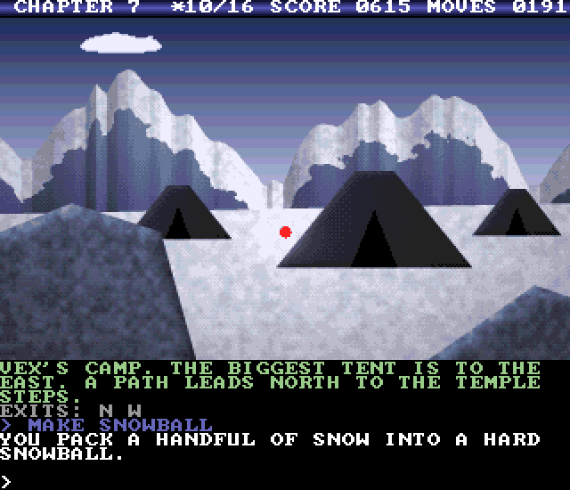 |
| 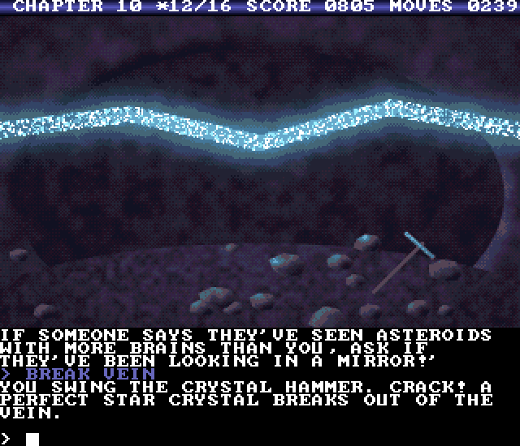 | 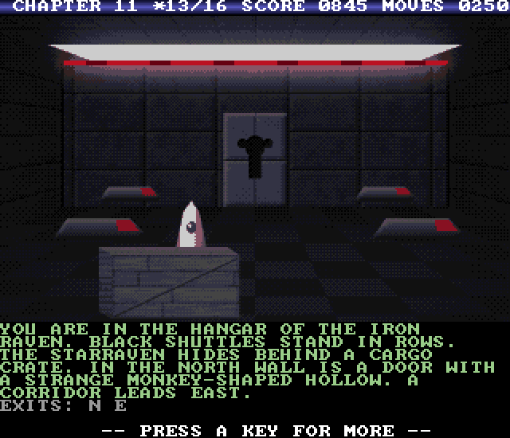 |
| 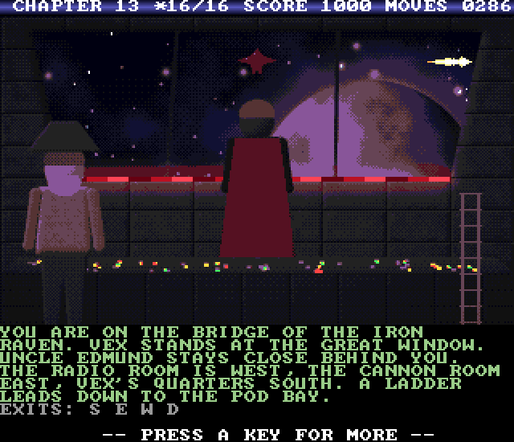 | 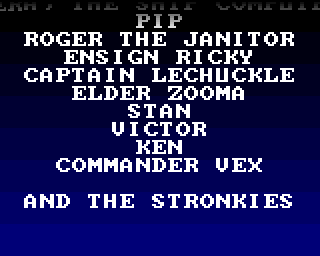 |

## Version numbers

| Version | Date | Notes |
|---|---|---|
| V2.0 | 6 Nov 2026 | All 81 pictures painted again for the Amiga, sampled sound effects, speech, three disks |
| V1.0 | 6 Nov 2026 | First Amiga 500 version: the complete C64 adventure (V1.7) on one bootable disk |

## Change log

### V2.0
- New graphics: all 81 pictures are new paintings made for the Amiga, in 320x192 pixels and 32 colours, instead of the C64 pictures scaled up. Every picture has its own palette, a copper sky with a colour on every line, and up to 16 cycling colours.
- A new picture for the epilogue: the garden of Ravenmoor in the morning, with the STARRAVEN on the lawn
- Speech: "Welcome to the World of Stronkie!" on the title screen, every title card speaks the name of the next part, NOVA speaks her lines (31 of them) in a robot voice, and you hear "You have died." and "Congratulations!"
- Sampled sound effects instead of the synthesized ones: key click, take, drop, error, points, door, thunder, zap, rocket launch, hyperspace, computer beep, death and victory
- Title cards: the name of the next part on a copper gradient, spoken while the part loads
- The title screen scroller tells about the new version
- The game now comes on three disks (`Stronkie`, `Stronkie2` and `Stronkie3`). It asks for the right disk when it needs it, finds a disk in any drive (a second drive saves swaps) and can be played from a hard disk.
- Games are saved on the disk of the part you are in.
- The walkthrough still scores 1070 points

### V1.0
- The complete C64 adventure (V1.7) on one bootable Amiga disk: all 17 parts, the same parser and the same puzzles, MAP, HINT, three save slots and the true ending.
- Room pictures in 320x192 with 32 colours, Scale2x smoothing, copper sky gradients on every line, colour cycling, palette fades and lightning flashes.
- Moving sprites, a smooth-scrolling text window, a raster bar behind the status line.
- New title screen with copper bars, a scroller and an original 4-voice title tune.
- Title cards with the first room of the next part while it loads. The music keeps playing while the disk loads.
- Paula music on 3 voices and sound effects on the 4th voice.
- Rolling end credits with copper fades.
